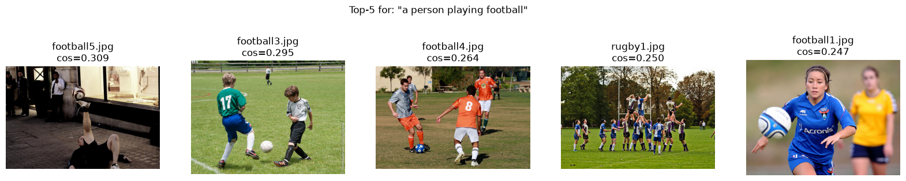

# Vision-Language Models Lab: CLIP & LLaVA

> Practical laboratory exploring multimodal AI through zero-shot classification, semantic retrieval, visual question answering, and hallucination analysis.

## 📋 Overview

This lab provides hands-on experience with two foundational vision-language models:

- **CLIP** (Contrastive Language-Image Pre-training): Image-text matching, zero-shot classification, and semantic image retrieval
- **LLaVA** (Large Language and Vision Assistant): Visual understanding, question answering, and conversational image analysis

### Key Learning Outcomes

- Understand how vision-language models bridge visual and textual modalities
- Implement zero-shot classification without task-specific training
- Build semantic image search systems
- Evaluate multimodal model performance
- Identify and analyze visual hallucinations
- Develop a practical multimodal assistant application

## 🚀 Quick Start

### Installation

```bash
# Create virtual environment
uv venv --python 3.11 .venv && source .venv/bin/activate

# Install PyTorch with CUDA support
uv pip install torch torchvision --index-url https://download.pytorch.org/whl/cu128

# Install dependencies
uv pip install -r requirements.txt
```

### Run the Lab

```bash
# Launch Jupyter notebook
jupyter lab lab/lab_clip_llava.ipynb
```

### Try the Mini-Project

```bash
# Single image question answering
python mini_project/assistant.py --image lab/images/ex11_vqa/kitchen1.jpg --question "What is the man doing?"

# Multi-image retrieval + explanation
python mini_project/assistant.py --query "a person playing football" --image-dir lab/images/ex07_retrieval --k 3
```

## 📁 Project Structure

```
Clip_LLava_lab/
├── lab/
│   ├── lab_clip_llava.ipynb    # Main notebook (Q1-Q36 + all exercises)
│   ├── images/                  # Exercise datasets
│   └── results/                 # Evaluation outputs
├── mini_project/
│   └── assistant.py             # Multimodal assistant (final deliverable)
├── clip/                        # CLIP utilities and scripts
├── llava/                       # LLaVA utilities and scripts
├── common/                      # Shared helper functions
└── requirements.txt             # Python dependencies
```

## 📊 Lab Results

### Experiment Summary

| Exercise | Task | Location | Performance |
|----------|------|----------|-------------|
| Ex 1-4 | CLIP fundamentals | [`lab_clip_llava.ipynb`](lab/lab_clip_llava.ipynb) | Q1-Q13 answered |
| Ex 5 | Classification evaluation | [`results/clip_eval.csv`](lab/results/clip_eval.csv) | **93.3% accuracy** (14/15 images) |
| Ex 6 | Prompt engineering | notebook cells | Multiple prompt strategies tested |
| Ex 7-8 | Image retrieval | [`results/top5_retrieval.png`](lab/results/top5_retrieval.png) | Top-5 semantic matches |
| Ex 9-10 | LLaVA architecture & VQA | notebook cells | Q24-Q26 + initial tests |
| Ex 11 | VQA evaluation | [`results/vqa_results.csv`](lab/results/vqa_results.csv) | **68% accuracy** (17/25 questions) |
| Ex 12 | Hallucination analysis | notebook cells | "Red Schwinn bicycle" fabrication |
| Ex 13 | Model comparison | notebook cells | Q33-Q36 comparative analysis |
| Final | Multimodal assistant | [`mini_project/assistant.py`](mini_project/assistant.py) | CLIP retrieval + LLaVA reasoning |



## 🔧 Technical Specifications

### Models Used

**CLIP**: `openai/clip-vit-base-patch32`
- Vision Transformer (ViT-B/32) + text encoder
- Used in exercises 1-8, 13
- Lightweight, runs on most GPUs

**LLaVA**: `llava-hf/llava-v1.6-mistral-7b-hf` (LLaVA-NeXT)
- CLIP ViT-L/14-336 vision encoder
- MLP projection layer
- Mistral-7B language model
- Used in exercises 9-13 and mini-project
- Requires ~16 GB GPU memory

### Hardware Requirements

- **GPU**: 32 GB NVIDIA GPU recommended (tested on A100/V100)
- **Precision**: BF16 for efficiency
- **Generation**: Greedy decoding for reproducibility

### Environment

- **Python**: 3.11
- **PyTorch**: 2.11.0+cu128
- **Transformers**: 5.20.1
- Full pinned versions in `requirements.lock.txt`

## 🖼️ Dataset Information

All images sourced from **COCO val2017** with proper licensing.

| Dataset | Images | Purpose | Details |
|---------|--------|---------|---------|
| `lab/image.jpg` | 1 | Primary test image | Two cats (Ex 2-4, 6, 13) |
| `ex05_eval/` | 15 | Classification test | 6 classes, edge cases included |
| `ex07_retrieval/` | 20 | Semantic search | 4 football + 1 rugby distractor |
| `ex11_vqa/` | 5 | Question answering | People, objects, classroom scene |
| `ex12_hallucination/` | 1 | Hallucination test | Street scene (no bicycle) |

Image sources and licenses documented in [`lab/images/SOURCES.md`](lab/images/SOURCES.md).

## 📝 Deliverables Checklist

- [x] Complete Jupyter notebook with all cells executed
- [x] Answers to all 36 questions (Q1-Q36)
- [x] CLIP zero-shot classification implementation
- [x] Model evaluation with accuracy metrics
- [x] Text-to-image retrieval system
- [x] LLaVA visual question answering
- [x] Hallucination detection and analysis
- [x] Comparative analysis (CLIP vs LLaVA)
- [x] Multimodal assistant application
- [x] Conclusion and insights

## 🎓 Educational Context

**Level**: PhD / Advanced Graduate
**Domain**: Computer Vision, Natural Language Processing, Multimodal AI
**Format**: Hands-on laboratory with theoretical questions

**Recommended Prerequisites**:
- Deep learning fundamentals
- PyTorch experience
- Transformer architecture knowledge
- Python proficiency

## 📚 References

- [CLIP Paper](https://arxiv.org/abs/2103.00020) - Learning Transferable Visual Models From Natural Language Supervision
- [LLaVA Paper](https://arxiv.org/abs/2304.08485) - Visual Instruction Tuning
- [COCO Dataset](https://cocodataset.org/) - Common Objects in Context

## 📄 License

Educational and research use. Dataset images follow COCO val2017 licensing terms.
